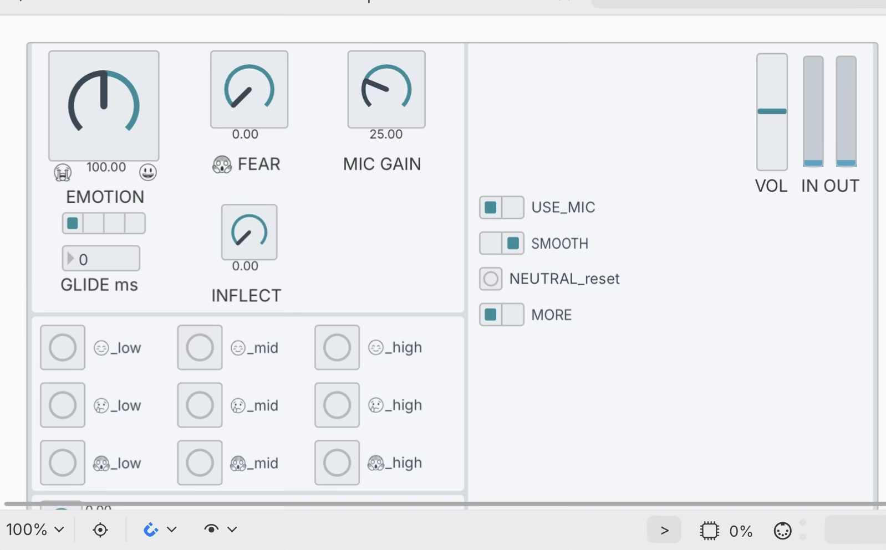

# Vocal emotion feedback

Live sad / happy / afraid voice effect for plugdata (iOS). Based on Rachman et al. 2018 (DAVID) and Aucouturier et al. 2016. Independent re-implementation, not endorsed by the authors. Live effect, requires wired headphones, preferably closed-back or noise-cancelling.

## Files
- `vocal-emotion-feedback.pd` - the patch for plugdata (uses ELSE `knob`)
- `vocal-emotion-feedback-desktop.pd` - same patch for vanilla Pure Data (the five knobs are sliders)
- `panel-plugdata.jpg` - the panel in plugdata
- `panel-desktop.png` - the panel, desktop version
- `LICENSE` - MIT

## Use
1. Put `vocal-emotion-feedback.pd` in plugdata's folder and open it.
2. DSP on, run mode.
3. Tick USE_MIC.
4. With a noisy mic, raise GATE until the hiss stops.

Requires these objects (all vanilla Pd): `sigmund~` `expr` `expr~` `fexpr~` `samphold~` `rzero~` `vline~` `delread4~` `biquad~`. The plugdata file also needs ELSE `knob` (bundled with plugdata, ELSE 1.0-0 RC9 or newer). If `sigmund~` is missing, turn SMOOTH off.

## Todo

### First
- Download the reference docs for the items below: Giannoulis, Massberg & Reiss, JAES 2012 (expander); the pitch-correction patent US 9747918 (voicing and delay handling); Valhalla's H949 de-glitching article and the McGill pitch-shifting notes (crossfade and pitch-synchronous windows); the plugdata patching basics page and a Pd `$0` guide (`$0` prefix)
- Voicing-aware window freeze (freeze last good window on low confidence / pitch=0, gentle crossfade on re-lock). With SMOOTH on, the shifter window follows the tracked pitch period. Already in place: pitches outside 70-500 Hz are ignored (the window keeps its last value), window changes ramp over 60 ms, and each tap only takes a new window at the end of a sweep. Still missing: unreliable pitches inside 70-500 Hz (noise, breath) still move the window, so a confidence check is needed before a value is accepted.
- Delay-time slew limiter (~1-2 oct/s max). The shifter works by changing a delay time, so a sudden jump in delay is heard as a click or a pitch swoop. Limiting how fast the delay time may change keeps it smooth.
- Unique `$0` prefix on all `vfb-` names. The control values travel by shared names with a fixed prefix, so two copies open at once interfere (see Known issues). A per-instance `$0` prefix would let several copies coexist.
- Soft-knee expander instead of hard gate. GATE currently opens fully the moment the level passes its threshold and fades out with a fixed release of about 50 ms below it, which can chop quiet word endings. An expander turns the level down gradually, in proportion to how far below the threshold it is.

### Then
- Adaptive onset detector (noise-floor threshold + hold-off). Now: a fixed threshold of 0.08 (about -22 dBFS), re-armed after 300 ms below it, at most one onset per 500 ms
- Table-driven inflection envelope (replace long breakpoint message). Now: each swoop is a vline~ message of about 4 ms breakpoints (subpatches `infl`, `infl2`, `infl2s`)
- Continuous emotion→cents curves + global Intensity control
- Fix long-glide deviation (>500 ms)

### After that
- Pre-emphasis shelf for pitch tracker only
- Restore last preset on load
- Extra diagnostics (voicing confidence, window length)
- Dynamic opposing shelf for basic formant compensation (controlled by current cents)
- Optional mild amplitude modulation with the vibrato
- Optional ANGUS roughness for afraid: sub-harmonics by amplitude modulation at f0/k, high-passed at 4*f0 (Liuni et al. 2020, arXiv:2008.11241). Needs gating when the pitch is lost. Effect on perceived fear untested

## Structure
The panel is the graph-on-parent area of the `emotion-voice` subpatch. Below it, out of view, each stage is a subpatch. Each one opens with a comment saying what it does, and comments below the objects explain the numbers that are not obvious.

| Row | Stages |
|---|---|
| Top row: audio path, left to right | `live_input` (mic, 80 Hz high-pass, gate, USE_MIC, MIC GAIN), `window_length`, `delay_line`, `delay_tap_1`, `delay_tap_2`, `high_shelf` (taps summed, 8 kHz shelf), `output` (VOL, clip, headphones) |
| Second row: pitch and timing | `pitch_control` (EMOTION to cents, glide, vibrato), `inflection` (swoops), `shifter_speed` (cents to tap speed), `onset_detector`, `option_switches` |
| Third row: panel helpers | `startup` (defaults, DSP on), `presets`, `glide_steps`, `more_menu` |
| Bottom row: tools | `console_meters`, `recorder` |

Control values travel by name (prefix `vfb-`). Audio stays on wires. The pitch shifter is a two-tap delay line: each tap sweeps across the window and is faded with a Hann weight, the two taps half a sweep apart.

## Controls
| Control | Function |
|---|---|
| EMOTION | left sad, centre neutral, right happy |
| FEAR | afraid vibrato, about 8.5 Hz, up to +-40 cents (+-33 with FEMALE_VOICE) |
| INFLECT | pitch swoop at phrase start, 0 = off (default) |
| Presets | NEUTRAL, HAPPY / SAD / AFRAID at low / mid / high |
| MIC GAIN | 25 = unity |
| VOL | fader, default 50, output clipped at +-0.95 |
| GATE 0=off | 0 = off, 1-100 = -69.5 to -20 dBFS |
| GLIDE ms | 0 = jump. The four-step radio picks 0 / 150 / 500 / 2000 ms |
| USE_MIC | mic on |
| SMOOTH | on (default): shifter window follows the pitch period (about 20 ms). off: fixed 10 ms |
| NEUTRAL_reset | button, resets to no effect |
| MORE | shows the option switches below |

| Option (under MORE) | Default | Function |
|---|---|---|
| RECORD_(may_fail) | off | writes `live_rec.wav` next to the patch: 16-bit stereo, left = mic after gate, USE_MIC and MIC GAIN, right = output |
| SHELF_2nd-order | off | a single 2nd-order shelf instead of the 5th-order one |
| FEMALE_VOICE | off | DAVID's female values for the afraid vibrato depth and swoop size (the swoop size even when AFRAID_SWOOP_SIZE is off) |
| SMALLER_PITCH | off | happy up to +30 cents, sad down to -50 |
| PAPER_LEVELS | on | DAVID Table 2 levels between the preset points (see below) instead of linear scaling |
| AFRAID_SWOOP_150ms | off | 150 ms afraid swoop instead of 500 ms |
| AFRAID_SWOOP_SIZE | off | DAVID Table 2 male afraid swoop sizes instead of the full +-200 cents. FEMALE_VOICE overrides it with the female sizes |

## Parameters
| | Pitch (cents) | High band above 8 kHz | Other |
|---|---|---|---|
| Happy low / mid / high | about +30 / +41 / +50 | up to about +9.5 dB/oct | inflection -200..+140 cents, 500 ms |
| Sad low / mid / high | about -40 / -56 / -70 | down to about -12 dB/oct | |
| Afraid low / mid / high | | | vibrato about 8.5 Hz (30% rate spread), 26 / 34 / 40 cents deep. With INFLECT: swoop starting at +120 cents, swinging +-200, 500 ms |

The high band is approximated by a 5th-order Butterworth shelf (two biquads and a first-order section), with one precomputed coefficient set per sample-rate band (up to 46 kHz, up to 68, up to 92, above).

## Where the numbers come from
The presets follow DAVID (Rachman et al. 2018, Table 2), not the original 2016 experiment (Aucouturier et al.). The 2016 study used a hardware processor, then a Max/MSP port, with different values: pitch +25 cents happy / -30 sad, happy inflection starting at -50 cents (400 ms), afraid vibrato 15 cents deep, happy compression, a sad formant shift (ratio 0.9) and 2nd-order shelves, with the effects ramped in over 5 minutes. This patch has no compression, formant shift or slow ramp.

| Setting | Source |
|---|---|
| Happy / Sad low, mid, high buttons | DAVID Table 2: +29.5 / +40.9 / +50.0 and -39.8 / -56.2 / -70.0 cents |
| Afraid low, mid, high buttons | DAVID Table 2: vibrato depth 26 / 34 / 40 cents (male), 13.7 / 20.2 / 33.0 (FEMALE_VOICE) |
| PAPER_LEVELS (on by default) | DAVID Table 2 at the preset points: happy swoop depth -145 / -159 / -200 cents, shelf slopes +5.8 / +6.6 / +9.5 (happy) and -7.8 / -9.6 / -12 dB/oct (sad). Off: linear scaling up to the high values |
| AFRAID_SWOOP_SIZE, FEMALE_VOICE | afraid swoop size from DAVID Table 2 (+-109 / 141 / 169 cents male, +-50 / 101 / 159 female) instead of a full +-200 cents |
| AFRAID_SWOOP_150ms | both afraid swoops start at +120 cents and swing +-200. The short one lasts 150 ms, the duration and start value of the 2016 afraid inflection |
| SMALLER_PITCH | this patch only: happy up to +30, sad down to -50 cents |

Caveats from the papers: in DAVID, recognition was above chance but modest (about 33-39% raw against 20% chance), the afraid effect is often heard as sad, and a stronger setting is less natural. The happy effect did not sound more intense at higher settings.

## Latency (roughly)
| Setting | Delay |
|---|---|
| SMOOTH off | about 5 ms |
| SMOOTH on | about 10 ms |

Only the shifter delay line adds delay: half the window, with no extra fixed offset. plugdata's audio buffers are additional.

## Console
| Line | Meaning |
|---|---|
| `startup_ran`, `samplerate` | once at load |
| `inflection_fired` | at each phrase onset. The swoop is only heard when INFLECT is above 0 |
| `mic_in_dB`, `after_gain_dB`, `out_dB` | raw mic, after USE_MIC and MIC GAIN, final output (100 = full scale) |
| `pitch_Hz` | tracked pitch, 0 = none |
| `window_ms` | shifter window |
| `shift_cents` | total pitch shift being applied (preset level plus vibrato and inflection) |
| `delay_ms` | shifter delay, window / 2, plugdata's buffers not included |

The lines from `mic_in_dB` down are printed once a second.

Tap a preset and read `shift_cents` and `delay_ms` to check the numbers in the tables above.

## Tested
Desktop Pd 0.54.1 with test tones and a file standing in for the mic: pitch, shelf gain, inflection, latency, gate, clipping and presets. The desktop file loads with no errors. Live on iPad with a USB headset.

The comment pass of 2026-10-12 changed only comments. It was checked in Pd 0.54.1: both files load as before, every object and connection is unchanged, and the comments survive a save in Pd.

## Known issues
- GLIDE deviates for about 0.5 s with a 2000 ms ramp.
- RECORD fails on iOS outside plugdata's folder.
- plugdata on iOS has no input chooser.
- Shared names use a fixed prefix, so two copies open at once interfere. Open one.
- Undecided: with FEMALE_VOICE on, the afraid swoop always uses DAVID's female sizes, even when AFRAID_SWOOP_SIZE is off. AFRAID_SWOOP_SIZE only switches the male sizes. It is not known whether this is intended, so the patch is left as it is and documented as it behaves.

## Credits
- Rachman, Liuni, Arias, Lind, Johansson, Hall, Richardson, Watanabe, Dubal, Aucouturier. DAVID: An open-source platform for real-time transformation of infra-segmental emotional cues in running speech. Behavior Research Methods 50:323-343 (2018). DOI 10.3758/s13428-017-0873-y. CC BY 4.0. The preset values (Table 2), the algorithm descriptions and the caveats in this README are taken or adapted from this paper.
- DAVID software, github.com/neuro-team-femto/david. MIT, Copyright (c) 2015 CNRS UMR 9912 STMS / IRCAM.
- Aucouturier, Johansson, Hall, Segnini, Mercadié, Watanabe. Covert digital manipulation of vocal emotion alter speakers' emotional states in a congruent direction. PNAS 113(4):948-953 (2016). DOI 10.1073/pnas.1506552113. The 2016 values quoted above are from the paper and its Supporting Information.
- Pure Data (including `sigmund~`), plugdata, ELSE (`knob`).

## Licence
MIT.
